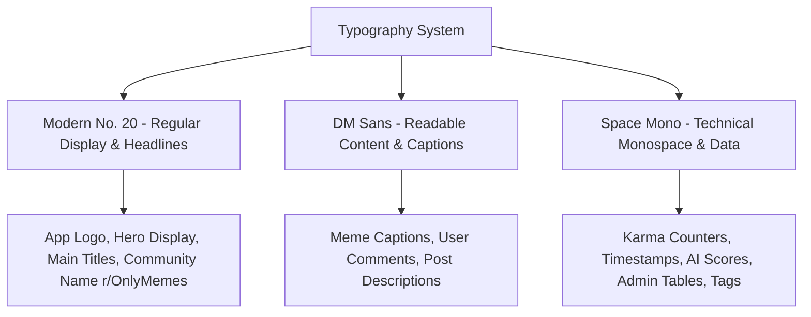

# Design System & UI/UX Specifications (Design.md)
## OnlyMeme: Kinetic Meme & Culture Engine
*Based on the Google Stitch Neo-Brutalist & Cyber-Vibrant Internet Culture Design System*

---

## 1. Design Philosophy & Brand Identity

The platform fuses **Neo-Brutalism** with **Cyber-Vibrant Internet Culture**: unashamedly high-contrast, kinetic, and razor-sharp, balanced by disciplined tabular density for backend moderation and analytics.

- **Electric & Unapologetic:** Intense neon strikes piercing through an ink-black graphite canvas create instant visual dopamine.
- **Micro-Precision Humor:** Meme cards, karma tags, and viral metrics are rendered with punchy, poster-like clarity.
- **Admin Rigor:** While the consumer stream is playful and reactive, the moderation portal is dense, analytical, and structured for zero-latency triage.
- **Elevation Model:** High-contrast 1px border layering (`#3d4a3d` / `#2E3648`) with **hard zero-blur offset drop shadows** (`2px 2px 0px #000`) rather than soft diffused blurs.

---

## 2. Color Palette & Stitch Design Tokens

```
+-----------------------------------------------------------------------------------+
|  SURFACE GRAPHITE TIERS                                                           |
|  [#0c0e14 Lowest] -> [#111319 Base] -> [#191b22 Low] -> [#1e1f26 Container]    |
|  -> [#282a30 High] -> [#33343b Highest]                                           |
+-----------------------------------------------------------------------------------+
|  KINETIC ACCENTS                                                                  |
|  [#4be277 Electric Lime (Primary)]       [#d0bcff Cyber Violet (Secondary)]       |
|  [#ffb0ce Neon Magenta (Tertiary)]       [#ffb4ab Crimson Alert (Error/Nuke)]     |
+-----------------------------------------------------------------------------------+
```

### 2.1 Graphite Canvas & Surface Hierarchy
| Token Name | Hex Code | Role in Application |
| :--- | :--- | :--- |
| `surface-container-lowest` | `#0c0e14` | Page base background, deep contrast floor |
| `surface` / `background` | `#111319` | App shell, sticky top header backdrop |
| `surface-container-low` | `#191b22` | Inner well containers, search inputs, nested modules |
| `surface-container` | `#1e1f26` | Meme cards, community sidebar widgets, dialog backdrops |
| `surface-container-high`| `#282a30` | Active button states, table headers, hover elevation |
| `surface-container-highest` | `#33343b` | Divider strokes, subtle accent backgrounds |
| `on-surface` | `#e2e2eb` | Primary crisp white typography, headlines |
| `on-surface-variant` | `#bccbb9` | Secondary descriptions, comment text, captions |
| `outline` | `#869585` | Inactive icon strokes, helper text, timestamps |
| `outline-variant` | `#3d4a3d` | Neo-brutalist structural borders (1px) |

### 2.2 Kinetic Accent System
| Token Name | Hex Code | Role in Application |
| :--- | :--- | :--- |
| **`primary` (Electric Lime)** | `#4be277` / `#22c55e` | Upvote active states, verified flairs, high AI score badges (80-100), primary CTAs |
| **`on-primary`** | `#003915` | Text placed directly on primary buttons |
| **`primary-fixed`** | `#6bff8f` | Hover highlights on primary buttons |
| **`secondary` (Cyber Violet)** | `#d0bcff` / `#571bc1` | Sub-hub badges (r/DankMemes, r/Tech), tag capsules, focus rings |
| **`tertiary` (Neon Magenta)** | `#ffb0ce` / `#ff83b8` | Virality surges, hot streaks, NSFW blur reveals, "Clip GIF" badge |
| **`error` / `error-container`** | `#ffb4ab` / `#93000a` | 1-Click Quick Delete ("Nuke") buttons, report flags, fake email alerts |

---

## 3. Typography Architecture: Modern No. 20 & High-Contrast Pairing

The typography system pairs the editorial elegance of **Modern No. 20 Regular** for branding and display with the readability of DM Sans and technical density of Space Mono:



### 3.1 Type Scales & Tokens
| Token | Font Family | Size / Line Height | Tracking | Weight | Role |
| :--- | :--- | :--- | :--- | :--- | :--- |
| `headline-xl` | **Modern No. 20** | 56px / 64px | 0.02em | 400 (Regular) | Hero landing display |
| `headline-lg` | **Modern No. 20** | 40px / 48px | 0.01em | 400 (Regular) | Major section headers, empty vault |
| `headline-md` | **Modern No. 20** | 28px / 36px | 0.01em | 400 (Regular) | Community titles, brand title |
| `headline-sm` | **Modern No. 20** | 20px / 28px | 0.00em | 400 (Regular) | Card headings, widget titles |
| `body-lg` | **DM Sans** | 18px / 28px | normal | 400 (Regular) | Featured captions |
| `body-md` | **DM Sans** | 15px / 22px | normal | 400 (Regular) | Primary captions, comments |
| `body-sm` | **DM Sans** | 13px / 18px | normal | 400 (Regular) | Timestamps, secondary notes |
| `label-lg` | **Space Mono** | 14px / 20px | 0.02em | 700 (Bold) | Nav buttons, pill actions |
| `label-md` | **Space Mono** | 12px / 16px | 0.04em | 700 (Bold) | Karma counters, AI score pills |
| `label-sm` | **Space Mono** | 10px / 14px | 0.06em | 700 (Bold) | Micro badges, status chips |

---

## 4. Layout Architecture: 12-Column Responsive Matrix

On desktop, OnlyMeme organizes content into a fluid **12-column layout** (`max-w-7xl mx-auto px-4`):

```
+----------------------------------------------------------------------------------------------------+
|  STICKY TOP HEADER: Logo [ONLYMEME] | Search [Ctrl+K] | [+ Create Meme] | [GIPHY] | [Profile Avatar] |
+----------------------------------------------------------------------------------------------------+
|  LEFT NAV RAIL (2 Cols)   |  CENTER MEME FEED STREAM (7 Cols)             | RIGHT SIDEBAR (3 Cols) |
|  - Feeds (Hot, New, Top)  |  - Filter Bar (Hot / Fresh / Dankest / Edgy)  | - r/OnlyMemes Info Card|
|  - Meme Hubs (r/Tech...)  |  - Active Feed Posts (Images, GIFs, Clips)    | - 14.2k Online Memers  |
|  - Tags (#gaming, #ai)    |  - AI Scorecard Pills & Reviews               | - Community Rules      |
|  - Admin Portal Link      |  - Action Toolbars (Comments, Like, Share)    | - Growing Meme Hubs    |
|                           |  - Infinite Scroll Sentinel                   | - AI Humor Spotlight   |
+----------------------------------------------------------------------------------------------------+
|  MOBILE REFLOW (< 1024px): Single 1-column stream with sticky top header and bottom action bar.     |
+----------------------------------------------------------------------------------------------------+
```

### 4.1 Layout Specifications
- **Left Rail (`lg:col-span-2`)**: Pinned navigation hosting curated feeds, sub-hubs, and quick shortcuts.
- **Center Stream (`lg:col-span-7`)**: Main content stream for meme cards, GIF players, and infinite scroll.
- **Right Rail (`lg:col-span-3`)**: Sticky community sidebar with live metrics, online members count, community rules accordion, and trending hubs ranking.
- **Mobile Mode**: Left and right rails collapse into drawer menus, giving 100% viewport width to the central meme stream.

---

## 5. Component Anatomies & Stitch Neo-Brutalist Specs

### 5.1 Neo-Brutalist Meme Content Card
```
+---------------------------------------------------------------------------------------+
| [r/] r/DankMemes • Posted by @dev_god [Space Mono: 2h ago] [🏷️ OC]           [...] [!] |
|---------------------------------------------------------------------------------------|
|  "When you push to prod at 5:00 PM on Friday and the CI pipeline passes"             |
|                                                                                       |
|  +---------------------------------------------------------------------------------+  |
|  |                                                                                 |  |
|  |                             MEDIA VIEWPORT                                      |  |
|  |                    (High-Res Image / Looping WebM GIF)                          |  |
|  |                                                                                 |  |
|  |  [🔊 0:14]                                             [⭐ AI SCORE: 94 DANK]   |  |
|  +---------------------------------------------------------------------------------+  |
|                                                                                       |
|  AI Critique (Space Mono): "Elite punchline timing. Code compiles without warnings."  |
|---------------------------------------------------------------------------------------|
|  [ ▲ 1.4k ▼ ]     [ 💬 341 Comments ]     [ ✂️ Clip GIF ]     [ ↗ Share ]     [ 🚩 ]   |
+---------------------------------------------------------------------------------------+
```

- **Card Container**: `bg-surface-container rounded-xl border border-outline-variant shadow-[2px_2px_0px_#000] p-space-md`.
- **Karma Cluster Pill**: `rounded-full bg-surface-container-low border border-outline-variant font-label-md text-label-md` with green upvote highlight (`text-primary border-primary`).
- **AI Score Pill**: `font-label-sm px-2 py-0.5 rounded bg-surface-container-lowest/80 backdrop-blur border border-primary text-primary font-bold`.
- **Action Toolbar**: `border-t border-surface-container-high pt-space-xs mt-space-sm flex items-center justify-between`.

---

### 5.2 Super-Admin Moderation Matrix (`/admin`)
Dense tabular rows (`36px` row height) built for rapid inspection, inspired by the Stitch Super-Admin spec:

```
+---------------------------------------------------------------------------------------------------------+
| 🛡️ ONLYMEME ADMIN MODERATION ENGINE                                  [Active Queue: 4] [⚡ Rapid Mode: ON] |
|---------------------------------------------------------------------------------------------------------|
| ID     | POST PREVIEW        | REPORT REASON  | AI SEXUALITY | AI VULGARITY | REPORTER | ACTIONS        |
|--------|---------------------|----------------|--------------|--------------|----------|----------------|
| #1042  | [Thumb] "Spicy..."  | ⚠️ Sexuality   | 0.74 (HIGH)  | 0.12 (LOW)   | @user_88 | [⚡ QUICK NUKE] |
| #1039  | [Thumb] "Rage..."   | 🤬 Vulgarity   | 0.02 (CLEAN) | 0.89 (HIGH)  | @anon_12 | [⚡ QUICK NUKE] |
| #1031  | [Thumb] "Repost..." | 🪓 Spam/Bot    | 0.00 (CLEAN) | 0.05 (CLEAN) | @mod_01  | [ Dismiss ]    |
+---------------------------------------------------------------------------------------------------------+
```

- **Row Highlighting**: Amber tint (`bg-amber-950/20`) for flagged posts, Crimson highlight (`bg-red-950/30`) for high-severity sexuality/hate violations.
- **1-Click Quick Delete ("Nuke") Button**:
  - `bg-error hover:bg-error-container text-on-error font-label-sm px-3 py-1 rounded shadow-[2px_2px_0px_#000] active:translate-y-0.5 transition-all`.
  - Instantly deletes Firestore post document, purges Firebase Storage file, and marks reports as resolved in `< 400ms`.

---

### 5.3 Guest Login Interception Modal (`AuthModal`)
- **Backdrop**: `bg-surface-container-lowest/90 backdrop-blur-xl`.
- **Card**: `bg-surface-container border border-outline-variant rounded-xl shadow-[4px_4px_0px_#000] p-space-lg max-w-md w-full`.
- **Google Sign-In Button**:
  - `bg-primary hover:bg-primary-fixed text-on-primary font-headline-sm font-bold py-2.5 px-space-lg rounded shadow-[2px_2px_0px_#000] active:translate-y-0.5 transition-all w-full flex items-center justify-center gap-2`.
- **Anti-Fake Email Banner**:
  - Appears with Crimson background (`bg-error-container text-on-error-container border border-error p-3 rounded font-body-sm`).

---

### 5.4 Fabric.js Meme Maker Studio Modal
- **Canvas Wrapper**: Centered inside `bg-surface-container-low rounded-xl border border-outline-variant p-4`.
- **Toolbar**: Neo-brutalist buttons with hard drop shadows for `[ Add Top Text ]`, `[ Add Bottom Text ]`, `[ Search GIPHY ]`, `[ Export ]`.
- **Font Selection**: Primary `Impact`, secondary `Space Grotesk`, `Anton`, `Bangers`.

---

## 6. Micro-Interactions & Motion Choreography

1. **Neo-Brutalist Button Hover & Active Press**:
   - `hover:translate-x-[-1px] hover:translate-y-[-1px] hover:shadow-[3px_3px_0px_#000]`
   - `active:translate-x-[1px] active:translate-y-[1px] active:shadow-[1px_1px_0px_#000]`
2. **Upvote Ignition**:
   - Monospace counter pops green with a neon pulse glow (`box-shadow: 0 0 12px rgba(75, 226, 119, 0.4)`).
3. **AI Scanline Effect**:
   - Electric Lime laser line (`h-0.5 bg-primary shadow-[0_0_10px_#4be277]`) sweeps vertically across media previews during content moderation.
