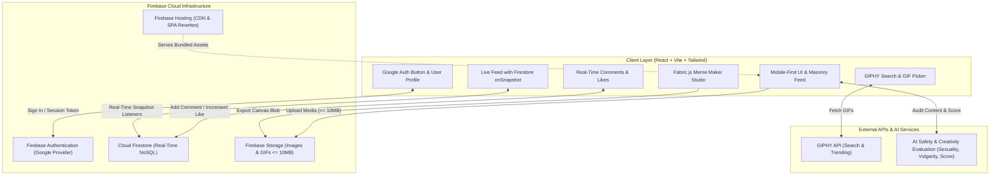
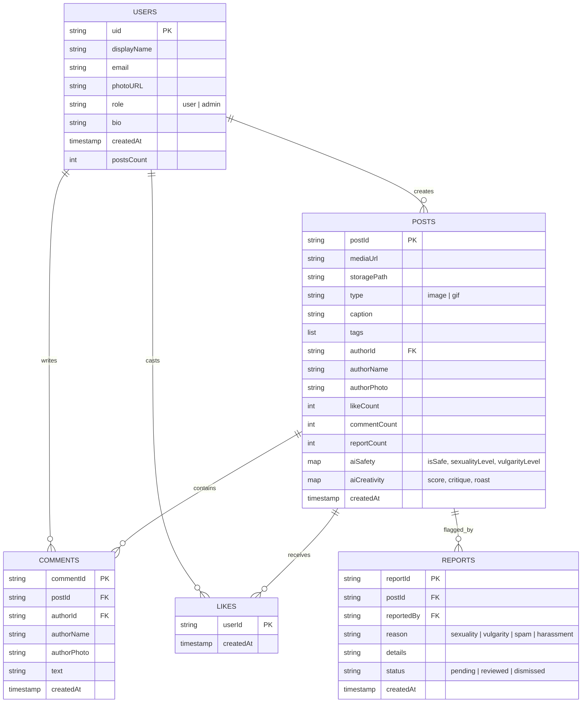
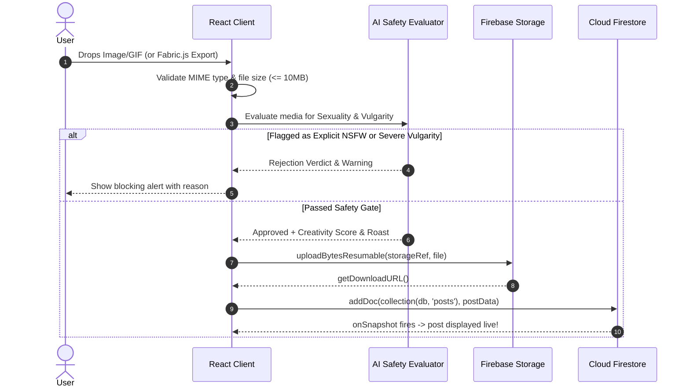

# System Architecture Specification
## Real-Time Meme-Sharing Web App (OnlyMeme)

**Stack:** React 19 / Vite + Tailwind CSS + Firebase (Auth, Firestore, Storage, Hosting) + Fabric.js + GIPHY API  
**Target:** High-performance, mobile-first responsive real-time social application.

---

## 1. System Overview & Component Diagram



### 1.1 Access Control Matrix: Guest Browsing vs. Authenticated Creators

| User Action | Unauthenticated Guest | Authenticated User | Admin |
| :--- | :---: | :---: | :---: |
| **Browse Meme Feed & Masonry Grid** | ✅ Allowed (No login required) | ✅ Allowed | ✅ Allowed |
| **View Animated GIFs & Images** | ✅ Allowed | ✅ Allowed | ✅ Allowed |
| **View Comments & AI Scores/Roasts** | ✅ Allowed | ✅ Allowed | ✅ Allowed |
| **Search Memes & Filter Categories** | ✅ Allowed | ✅ Allowed | ✅ Allowed |
| **Upload Image / GIF Meme** | 🔒 Intercepted -> Triggers Login Modal | ✅ Allowed | ✅ Allowed |
| **Open Meme Maker Studio & Post** | 🔒 Intercepted -> Triggers Login Modal | ✅ Allowed | ✅ Allowed |
| **Like a Post / Write Comments** | 🔒 Intercepted -> Triggers Login Modal | ✅ Allowed | ✅ Allowed |
| **Flag / Report Inappropriate Meme** | 🔒 Intercepted -> Triggers Login Modal | ✅ Allowed | ✅ Allowed |
| **Admin Portal & 1-Click Quick Delete** | 🚫 Forbidden | 🚫 Forbidden | ✅ Allowed |

### 1.2 Email Integrity & Anti-Dummy/Fake Email Pipeline
To prevent bot attacks, spam networks, and throwaway accounts, authentication enforces a 4-tier email integrity filter:
1. **Google OAuth `emailVerified` Check**:
   - Only Google accounts with a verified primary email (`user.emailVerified === true` in Firebase Auth token) are accepted.
2. **Disposable & Burner Domain Blocklist**:
   - Compares the email domain against a comprehensive repository of known temporary/throwaway email providers (e.g. `mailinator.com`, `tempmail.com`, `10minutemail.com`, `guerrillamail.com`, `sharklasers.com`, `trashmail.com`, `yopmail.com`, `dispostable.com`, `throwawaymail.com`, `getnada.com`).
3. **Dummy Pattern & Entropy Heuristics**:
   - Flags suspicious bot patterns (e.g. `test12345@`, `asdfghjk@`, `dummyfake@`, repetitive character sequences, or high Shannon entropy strings typical of automated burner account generators).
4. **Immediate Rejection & Session Revocation**:
   - If a detected dummy or disposable address attempts login, the session is immediately signed out (`auth.signOut()`), the user record is denied creation in Firestore, and an alert is displayed explaining why the account was rejected.

---

## 2. Technology Stack & Key Dependencies

| Layer | Technology | Purpose & Rationale |
| :--- | :--- | :--- |
| **Build & Runtime** | `React (v18/19) + Vite` | Instant HMR, lightning-fast dev server, optimized tree-shaken production bundles. |
| **Design System** | `Google Stitch "Kinetic Meme & Culture Engine"` | Neo-Brutalism with cyber-vibrant internet culture, graphite surface tiers, and hard offset drop shadows (`shadow-[2px_2px_0px_#000]`). |
| **Styling** | `Tailwind CSS (v3/v4)` | Utility-first styling configured with Stitch surface tokens (`surface-container-low`), primary lime (`#4be277`), and secondary violet (`#d0bcff`). |
| **Typography** | `Google Fonts: Space Grotesk + DM Sans + Space Mono` | Space Grotesk for high-tension headlines, DM Sans for readable captions/comments, and Space Mono for karma counters and admin telemetry. |
| **Backend & Real-Time DB** | `Firebase Cloud Firestore` | Document-oriented real-time synchronization using WebSocket `onSnapshot` listeners. |
| **Authentication** | `Firebase Auth` | Google OAuth popup login, persistence, secure ID token exchange, email verification check. |
| **Media Storage** | `Firebase Cloud Storage` | Secure object storage for media with resumable uploads, progress tracking, and 10MB hard limit. |
| **Canvas Engine** | `Fabric.js` | Object-oriented HTML5 canvas library for text drag/drop, scaling, outline strokes, and meme export. |
| **GIF Provider** | `GIPHY API (SDK / REST)` | Rich trending GIF catalog and instant keyword search integration. |
| **Icons** | `Lucide React` & `Material Symbols` | High-quality, lightweight SVG iconography. |
| **AI Moderation & Scoring**| `Gemini Multimodal / AI Service` | Automated inspection of vulgarity, sexuality/NSFW visual content, and creativity score (0-100). |

---

## 3. Cloud Firestore Data Schema



### Collection Definitions

1. `users/{userId}`:
   - Profile documents auto-created upon first Google sign-in.
2. `posts/{postId}`:
   - Primary feed documents containing media references, captions, tags, and AI ratings.
3. `posts/{postId}/likes/{userId}`:
   - Subcollection ensuring atomic, idempotent 1-like-per-user tracking.
4. `posts/{postId}/comments/{commentId}`:
   - Subcollection for post comments, ordered chronologically.
5. `reports/{reportId}`:
   - Root collection for flagged content accessible only to admins.

---

## 4. Real-Time Data Flow & State Management

### 4.1 Real-Time Feed Architecture
- **Firestore Query**:
  ```javascript
  query(
    collection(db, "posts"),
    orderBy("createdAt", "desc"),
    limit(12)
  );
  ```
- **Real-Time Listener**: Uses `onSnapshot` to automatically inject new posts into the feed without page reloads.
- **Infinite Scroll**: Uses `IntersectionObserver` on a sentinel element at the bottom of the feed. When visible, queries `startAfter(lastVisibleDoc)` for seamless cursor pagination.
- **Optimistic UI**:
  - Likes update the local count and toggle heart state instantly.
  - Background task triggers `runTransaction` or `updateDoc` with `increment(1)` / `increment(-1)`.

### 4.2 GIPHY API Integration
- Direct client search against `https://api.giphy.com/v1/gifs/search` with API key.
- Debounced search input (300ms) with categories (Trending, Reactions, Memes).
- Direct selection passes the high-res or downsized GIF URL to the post creator or Fabric.js canvas.

### 4.3 Fabric.js Meme Maker Engine
- Renders an interactive `<canvas>` element.
- Loads user image or selected GIF frame into canvas background.
- Adds editable `fabric.IText` objects for Top and Bottom text:
  - Font: `Impact`, `Anton`, or `Bangers`.
  - Fill: `#FFFFFF`, Stroke: `#000000`, StrokeWidth: `2-4px`.
  - Uppercase formatting, centered alignment.
- Exports canvas via `canvas.toBlob('image/webp', 0.92)` and streams directly to Firebase Storage.

### 4.4 Admin Moderation & 1-Click Quick-Delete Architecture
- **Admin Dashboard Route (`/admin`)**:
  - Restricted to authenticated users with `role: 'admin'` or matching an admin email whitelist in environment variables.
  - **Live Incident Stream**: Real-time Firestore listener on `reports` collection where `status == 'pending'`.
  - **Triage Matrix**: Displays the reported meme image/GIF, reason (`sexuality`, `vulgarity`, `spam`), reporter details, and the automated AI Safety report.
- **Atomic 1-Click Quick Delete ("Nuke") Action**:
  - Instantly deletes the target post document from `posts/{postId}`.
  - Asynchronously purges the media file from Firebase Storage (`storage.deleteObject(ref)`).
  - Automatically updates all linked reports to `status: 'resolved'`.
  - Emits real-time notification to all active feeds via Firestore listener, instantly removing the post from public view.

---

## 5. Media Upload & Validation Architecture



---

## 6. Firebase Setup & Configuration Guide

### 6.1 Prerequisites
1. Create a Firebase Project at [console.firebase.google.com](https://console.firebase.google.com/).
2. Enable **Authentication** -> Sign-in method -> **Google**.
3. Enable **Cloud Firestore** in Production mode.
4. Enable **Cloud Storage** in Production mode.
5. Create a Web App inside project settings and copy the config object.

### 6.2 Environment Variables (`.env.local`)
```env
VITE_FIREBASE_API_KEY=your_api_key_here
VITE_FIREBASE_AUTH_DOMAIN=your_project_id.firebaseapp.com
VITE_FIREBASE_PROJECT_ID=your_project_id
VITE_FIREBASE_STORAGE_BUCKET=your_project_id.firebasestorage.app
VITE_FIREBASE_MESSAGING_SENDER_ID=your_sender_id
VITE_FIREBASE_APP_ID=your_app_id
VITE_GIPHY_API_KEY=your_giphy_api_key_here
VITE_GEMINI_API_KEY=your_gemini_api_key_here
```

### 6.3 Firebase SDK Initialization Module (`src/firebase/config.js`)
```javascript
import { initializeApp } from 'firebase/app';
import { getAuth, GoogleAuthProvider } from 'firebase/auth';
import { getFirestore } from 'firebase/firestore';
import { getStorage } from 'firebase/storage';

const firebaseConfig = {
  apiKey: import.meta.env.VITE_FIREBASE_API_KEY,
  authDomain: import.meta.env.VITE_FIREBASE_AUTH_DOMAIN,
  projectId: import.meta.env.VITE_FIREBASE_PROJECT_ID,
  storageBucket: import.meta.env.VITE_FIREBASE_STORAGE_BUCKET,
  messagingSenderId: import.meta.env.VITE_FIREBASE_MESSAGING_SENDER_ID,
  appId: import.meta.env.VITE_FIREBASE_APP_ID
};

export const app = initializeApp(firebaseConfig);
export const auth = getAuth(app);
export const googleProvider = new GoogleAuthProvider();
export const db = getFirestore(app);
export const storage = getStorage(app);
```
